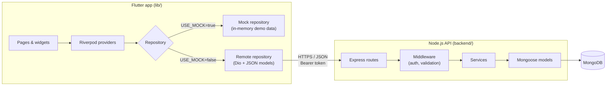
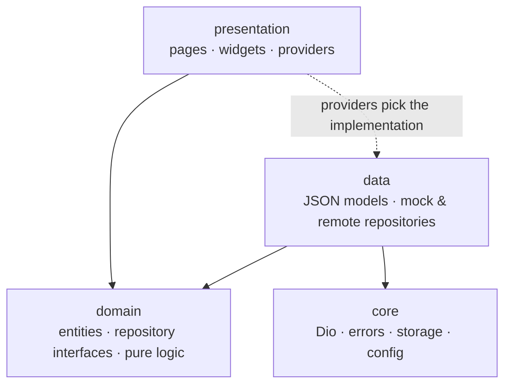
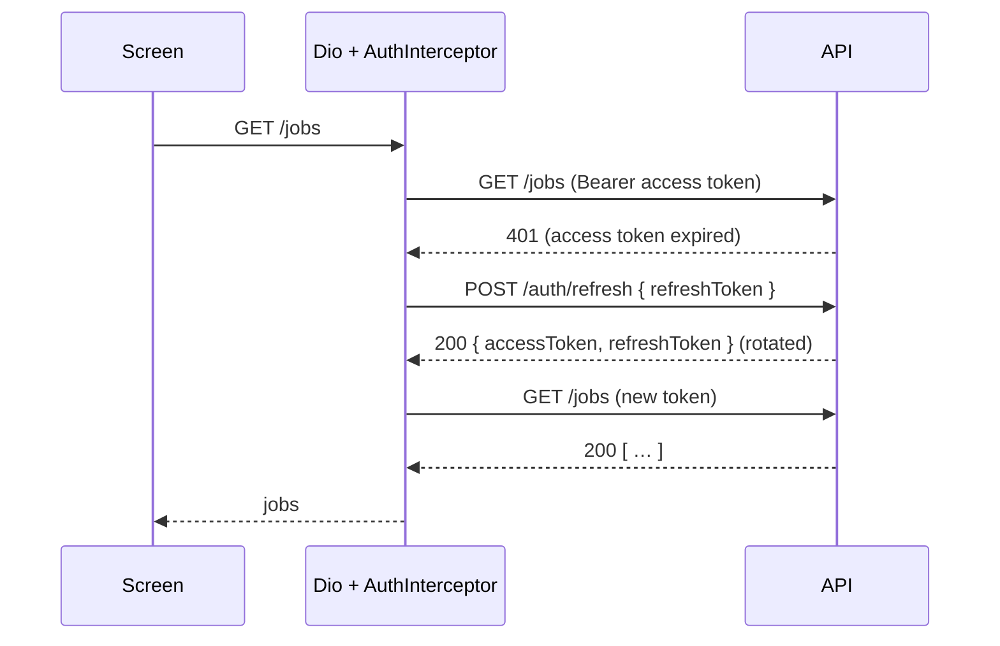
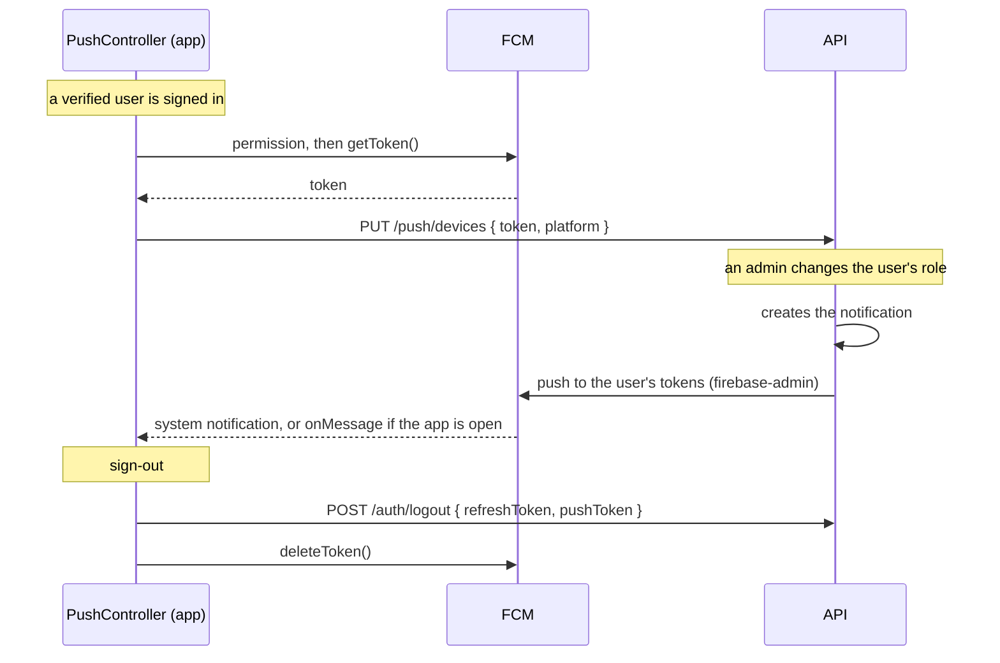
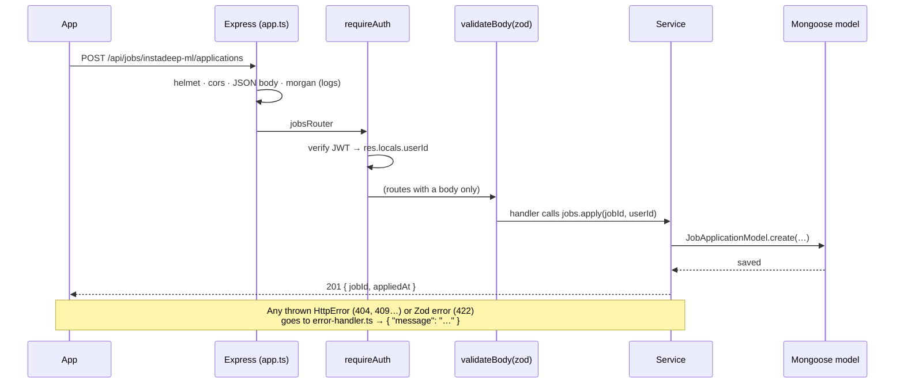

# Architecture

How CampusPulse is built, and why. Read this before changing code: it explains where every kind of file goes and how a tap on the screen reaches the database.

- [1. The big picture](#1-the-big-picture)
- [2. Repository structure](#2-repository-structure)
- [3. The Flutter app](#3-the-flutter-app)
- [4. The backend API](#4-the-backend-api)
- [5. How the app and the API stay in sync](#5-how-the-app-and-the-api-stay-in-sync)
- [6. Key decisions and trade-offs](#6-key-decisions-and-trade-offs)

---

## 1. The big picture

CampusPulse is a **mobile app** (Flutter) talking to a **REST API** (Node.js + Express) that stores its data in **MongoDB**. Both live in this repository.



Two things to remember:

1. **Every screen works without a server.** Each feature has a *mock* repository with demo data, and a *remote* repository that calls the API. One switch, `USE_MOCK`, picks which one the whole app uses (see [3.4](#34-mock-or-real-data-one-switch)).
2. **Both sides are organised by feature.** The app has a `lib/features/jobs/` folder, and the backend has a matching `backend/src/modules/jobs/` folder. When you work on a feature, you work in those two folders.

---

## 2. Repository structure

```text
campuslink_mobile/
├── lib/                    Flutter app source (see 3.1)
├── test/                   Flutter tests, mirroring lib/ (core/, features/<feature>/)
├── backend/                Node.js API (see 4.1), with its own package.json and tests
├── env/                    App build configurations (--dart-define-from-file)
│   ├── dev.json            Mock data, no server needed (default)
│   ├── local.json          Real API on your PC (Android emulator → 10.0.2.2:3000)
│   └── prod.json           Production API (placeholder URL)
├── docs/                   This documentation
├── android/ ios/ web/ …    Platform projects generated by Flutter
├── assets/images/          Static images
├── .vscode/launch.json     "Run" configurations: mock data / local backend
├── pubspec.yaml            Flutter dependencies
└── analysis_options.yaml   Lint rules (flutter_lints)
```

Git-ignored local files you will create yourself:

- `backend/.env`: secrets and settings for the API.
- `.mcp.json`: an optional Stitch design-tool key.

---

## 3. The Flutter app

**Stack:**

| Purpose | Package |
|---|---|
| Language and toolkit | Flutter 3.27+ (developed on 3.47), Dart 3 |
| State management | flutter_riverpod 2.6 |
| Navigation | go_router 14 |
| HTTP | dio 5 |
| Token storage | flutter_secure_storage |
| Settings (theme) | shared_preferences |
| Fonts | google_fonts (Plus Jakarta Sans + Inter) |

### 3.1 Folder structure

The app uses a **feature-first Clean Architecture**. Code is grouped by feature first, then split into three layers inside each feature.

```text
lib/
├── main.dart                 Entry point → bootstrap()
├── bootstrap.dart            Loads SharedPreferences, starts the ProviderScope
├── app.dart                  MaterialApp.router: theme, dark mode, router
│
├── core/                     Infrastructure used by every feature (no feature code here)
│   ├── config/env.dart           Build-time settings: ENV, API_BASE_URL, USE_MOCK
│   ├── error/                    Result<T>, Failure types, guard() + Dio error mapping
│   ├── network/                  Dio client, AuthInterceptor, ApiEndpoints (every API path)
│   ├── providers/                dioProvider, secureStorageProvider, clockProvider, theme
│   ├── router/                   go_router config, route paths, bottom-tab shell
│   ├── storage/                  SecureStorage (tokens), LocalPrefs (settings)
│   ├── theme/                    Design tokens: colours, spacing, radius, shadows, fonts
│   └── utils/                    Formatters (dates, durations…) and form validators
│
├── shared/widgets/           Reusable UI pieces: AppButton, AppCard, AppBadge, AppTextField,
│                             CampusHeader, DetailTopBar, state views, showAppSnack…
│
└── features/                 One folder per feature
    ├── auth/                 Login, register, verify email, password reset
    ├── home/                 Home & Today hub (presentation only: reuses other features' data)
    ├── timetable/            Weekly timetable
    ├── courses/              Course mastery & lessons
    ├── carpooling/           Rides: list, detail & booking, publishing
    ├── forum/                Forum hub: Covoiturage, Lost & Found, Ideas sections
    ├── jobs/                 Internship / job offers
    ├── grades/               Grades & academic transcript
    ├── profile/              Student profile & digital ID
    ├── notifications/        Notifications & alerts
    └── admin/                Administration (admins only): users, CSV import, audit log
```

**Inside a feature** (the example is `jobs/`, and every feature follows the same shape):

```text
features/jobs/
├── domain/                        WHAT the feature is: pure Dart, no Flutter, no HTTP
│   ├── entities/job.dart              Job, MissionItem (immutable classes)
│   └── repositories/job_repository.dart   abstract interface: getJobs(), getJob(), apply()
│
├── data/                          WHERE the data comes from
│   ├── models/job_models.dart         JSON → entity (JobModel.fromJson)
│   └── repositories/
│       ├── mock_job_repository.dart       In-memory demo data (USE_MOCK=true)
│       └── job_repository_impl.dart       Calls the API through Dio (USE_MOCK=false)
│
└── presentation/                  HOW it looks
    ├── providers/job_providers.dart   Picks the repository, exposes the data to the UI
    ├── pages/                         Full screens (JobsPage, JobDetailPage)
    └── widgets/                       Pieces of those screens (JobCard, …)
```

Some features also have pure logic next to the entities, for example `domain/course_logic.dart`, `domain/grading.dart` and `domain/schedule_logic.dart`. This logic has no UI and no I/O, so it is easy to unit-test.

### 3.2 The layers and the dependency rule



- **domain** depends on nothing. It defines what a `Job` is and what a `JobRepository` can do.
- **data** implements the domain interfaces. Only this layer knows about JSON, Dio or MongoDB ids.
- **presentation** talks to the *interface* `JobRepository`, never to `JobRepositoryImpl` directly. Only the provider file decides which implementation is used.
- **Features don't import each other's data layer.** When one screen shows another feature's data (e.g. Home shows today's classes), it reads that feature's **providers**: Home uses `todayTimetableProvider` and `highlightsProvider`.

### 3.3 State management with Riverpod

All state goes through Riverpod providers. No `setState` reaches into global state, and there are no singletons. Two kinds of state are handled this way:

| Kind | Provider type | Examples |
|---|---|---|
| A service object | `Provider` | `dioProvider`, `jobRepositoryProvider` |
| Data loaded once per screen | `FutureProvider.autoDispose` | `jobsProvider`, `todayTimetableProvider`, `coursesProvider` |
| Data for one item | `FutureProvider.autoDispose.family` | `jobDetailProvider(id)`, `rideDetailProvider(id)`, `timetableWeekProvider(monday)` |
| State with actions | `AsyncNotifierProvider` | `authControllerProvider` (login, logout…), `notificationsControllerProvider` (mark as read) |
| Small UI state shared across screens | `StateProvider` / `Notifier` | `forumSectionProvider`, `ideaUpvotesProvider`, `themeModeProvider` |
| Derived values | `Provider` | `unreadNotificationCountProvider`, `currentUserIdProvider` |

The typical read flow on a screen:

```dart
final jobs = ref.watch(jobsProvider);          // AsyncValue<List<Job>>
return jobs.when(
  loading: () => const LoadingView(),
  error: (e, _) => ErrorView(message: failureMessage(e), onRetry: () => ref.invalidate(jobsProvider)),
  data: (list) => JobsList(list),
);
```

Actions (apply, book a seat, publish…) call the repository, then **invalidate** the providers whose data changed, so the screens reload:

```dart
final result = await ref.read(jobRepositoryProvider).apply(job.id);
result.when(
  success: (_) => ref.invalidate(jobsProvider),   // the list now shows "Applied"
  failure: (f) => showAppSnack(context, f.message),
);
```

- **"Now" comes from a provider.** `clockProvider` ticks every 30 seconds, so countdowns like "in 18 min" stay live. Tests replace it with a fixed date.
- **Switching accounts:** `currentUserIdProvider` changes when another student signs in. Caches that outlive a screen watch it, so they reload instead of showing the previous student's data.

### 3.4 Mock or real data: one switch

Every feature's provider file chooses its repository the same way:

```dart
// lib/features/jobs/presentation/providers/job_providers.dart
final jobRepositoryProvider = Provider<JobRepository>((ref) {
  return Env.useMock ? MockJobRepository() : JobRepositoryImpl(ref.watch(dioProvider));
});
```

`Env.useMock` comes from the build configuration:

| Run with | `USE_MOCK` | Data |
|---|---|---|
| `env/dev.json` (default, VS Code "dev, mock data") | `true` | In-memory demo data, no server needed |
| `env/local.json` (VS Code "local backend") | `false` | The API running on your PC |
| `env/prod.json` | `false` | The production API (URL to be set) |

The mock repositories behave like the API: same validation messages, same refusals (e.g. applying twice, or booking your own ride). This lets you build and test a screen before its endpoint exists.

### 3.5 Errors: `Result` and `Failure`

The UI never sees a Dio exception or an HTTP status. Repositories return a `Result<T>`:

```dart
sealed class Result<T> { … }   // Success(value) | Err(failure)
```

Remote repositories wrap every call in `guard()` (`core/error/failure_mapper.dart`), which turns exceptions into typed `Failure`s:

| What happened | Failure | Message shown |
|---|---|---|
| Timeout | `TimeoutFailure` | "The request timed out." |
| No connection | `NetworkFailure` | "No internet connection." |
| HTTP 401 | `UnauthorizedFailure` | The server's message |
| HTTP 400 / 422 | `ValidationFailure` | The server's message (e.g. "Use at least 8 characters") |
| Other HTTP error | `ServerFailure` | The server's message |
| Anything else | `UnknownFailure` | "Something went wrong." |

The API always answers errors as `{ "message": "…" }` written for students, so the app can show them as-is. Inside `FutureProvider`s, `.unwrap()` turns an `Err` into a thrown `Failure`, and `failureMessage(error)` gets the text back for the `ErrorView`.

### 3.6 Networking and authentication

`dioProvider` builds a single Dio instance with `baseUrl = API_BASE_URL` and an `AuthInterceptor`:

- It adds `Authorization: Bearer <accessToken>` (read from secure storage) to every request, except those marked `AuthInterceptor.skipAuth`: login, register, forgot and reset password, and logout.
- On a **401**, it calls `/auth/refresh` once with the refresh token, saves the new pair and **retries** the request. Both calls go through a separate Dio without interceptors, so a failure can't loop. If the refresh fails, the session is over: the tokens are cleared and the router sends the student to the login screen.



- Tokens live in **`flutter_secure_storage`**: Keychain on iOS, encrypted storage on Android.
- On app start, `AuthController` restores the session by calling `GET /users/me`.
- Logout clears the tokens at once and revokes the session on the server in the background, so the user never waits.

### 3.7 Navigation

`go_router` with a `StatefulShellRoute` for the five bottom tabs. Each tab keeps its own navigation stack. Every path is a constant in `core/router/route_names.dart`, so pages never hard-code a path string.

| Path | Screen | Stitch design |
|---|---|---|
| `/auth/login` | `LoginPage` (also the onboarding screen) | 01 |
| `/auth/register` | `RegisterPage` | — |
| `/auth/forgot-password` | `ForgotPasswordPage` | — |
| `/auth/reset-password?email=` | `ResetPasswordPage` | — |
| `/auth/verify-email` | `VerifyEmailPage` | — |
| `/app/home` · tab | `HomePage` | 02 |
| `/app/timetable` · tab | `TimetablePage` | 03 |
| `/app/timetable/courses?course=` | `CoursesPage` | 04 |
| `/app/forum` · tab | `ForumPage` (Covoiturage, Lost & Found, Ideas) | 05, 07 |
| `/app/forum/rides/new` | `NewRidePage` (publish a ride) | — |
| `/app/forum/rides/:rideId` | `RideDetailPage` | 06 |
| `/app/jobs` · tab | `JobsPage` | 08 |
| `/app/jobs/:jobId` | `JobDetailPage` | 09 |
| `/app/profile` · tab | `ProfilePage` | 10 |
| `/app/profile/grades` | `GradesPage` | 11 |
| `/app/notifications` | `NotificationsPage` (over the tabs, no bottom bar) | 12 |
| `/app/profile/admin/users` | `AdminUsersPage` (admins only) | — |
| `/app/profile/admin/users/new` · `/:userId` | `UserFormPage` (add / edit an account) | — |
| `/app/profile/admin/import` | `ImportUsersPage` (CSV or pasted cells) | — |
| `/app/profile/admin/audit` | `AuditLogPage` | — |

**Redirect rules.** They live in `authRedirect()` in `app_router.dart` and are unit-tested:

- While the session is being restored → stay where you are.
- Signed out on an `/app/*` page or on verify-email → **login**.
- Signed in with an unverified email → **verify-email**.
- Signed in on an `/auth/*` page → **home**.
- Signed in, not an admin, on an `/app/profile/admin/*` page → **profile**. (The API refuses them anyway: this only keeps the screens out of reach.)
- Signed in as an admin or alumni on an `/app/timetable*` page → **home**. They have no timetable or courses: `User.hasClasses` is true only for students and teachers. `ShellScaffold` hides their Timetable tab, so they see four tabs.

### 3.8 UI system

- **Designs** come from the Google Stitch project "CampusPulse Student Companion Mobile App". Screens are numbered 01–12, as in the route table above.
- **Design tokens** are in `core/theme/`. Never write a hex colour or a raw padding in a widget:
  - `AppColors`: brand purple `#6949A8` and coral `#FF7A59`, success and warning colours, hero colours.
  - `AppSpacing`, `AppRadius` and `AppShadows`.
  - `AppTypography`: Plus Jakarta Sans for titles and labels, Inter for body text.
- **Light and dark themes** are built from the same tokens in `AppTheme`. Widgets use `Theme.of(context).colorScheme`, so dark mode works everywhere.
- **Shared widgets** live in `lib/shared/widgets/`. Reuse them before writing new ones:
  - `CampusHeader`: the top header of the tab pages.
  - `DetailTopBar`: the back pill of pushed pages.
  - `AppButton`, `AppCard`, `AppBadge` and `toneColors()`.
  - `AppTextField`, `AppSearchField`, `InfoBanner`, `StatTile`, `UserAvatar`.
  - `BottomActionBar`.
  - `LoadingView`, `ErrorView` and `EmptyView`.
  - `showAppSnack()`.

### 3.9 Push notifications

Firebase Cloud Messaging (FCM) delivers the API's notifications to the phone. Push is **optional**: without a Firebase config, everything else works the same.



- **Startup:** `bootstrap.dart` calls `startPushMessaging()`. It returns `null` (push off) in demo mode, on desktop or web, or when `Firebase.initializeApp()` finds no config.
  - The config is `android/app/google-services.json` or `ios/Runner/GoogleService-Info.plist`. Both are gitignored, and `app/build.gradle.kts` applies the Google Services plugin only when the Android file exists.
  - `pushMessagingProvider` then holds a `PushMessaging`, or `null`.
- **`PushController`** (`features/notifications/presentation/push_controller.dart`) lives as long as the app, because `CampusPulseApp` watches it. It listens to `authControllerProvider`:
  - **Signed in:** it registers the phone and keeps the token in `pushTokenProvider`.
  - **Signing out:** `AuthController.logout` sends that token with the logout request, so the API stops pushing to the phone. Then the token is deleted.
- **Receiving:**
  - **App in the background or closed:** Android shows the push on its own, in the "Campus updates" channel created in `MainActivity.kt`, with the `ic_stat_campuspulse` icon.
  - **App open:** the controller refreshes the notifications and shows a snackbar through `scaffoldMessengerKeyProvider`.
  - **Tapped:** the push opens the same route as in the list (`notificationRoute`) and is marked read.
- **Class reminders** are pushed by a job of the API (`timetable/class-reminders.ts`, started by `server.ts` when push is on). They carry no notification id and open the Timetable. Android shows them in a second channel, "Class reminders".
- **Tests** fake `PushMessaging` and `PushDeviceRepository` (`test/features/notifications/push_controller_test.dart`). Nothing touches Firebase.

---

## 4. The backend API

**Stack:**

| Purpose | Package |
|---|---|
| Runtime | Node.js 20+ (developed on 22) |
| HTTP framework | Express 5 |
| Language | TypeScript 6 (strict) |
| Database | MongoDB with Mongoose 9 |
| Validation | Zod 4 |
| Auth | jsonwebtoken (access tokens) and bcryptjs (passwords) |
| Security | helmet, cors, express-rate-limit |
| Email | nodemailer (SMTP) |
| Tests | Jest 30 + ts-jest + Supertest |
| Dev runner | tsx (watch mode) |

### 4.1 Folder structure

```text
backend/
├── src/
│   ├── server.ts            Starts the app: connects MongoDB, listens on HOST:PORT
│   ├── app.ts               Builds the Express app: security middleware, /api routers, error handler
│   ├── config/env.ts        Reads and validates .env with Zod (the server refuses to start if invalid)
│   ├── db/mongo.ts          connectMongo / disconnectMongo
│   ├── lib/
│   │   ├── http-error.ts        HttpError(status, message) + helpers (badRequest, unauthorized…)
│   │   └── validate.ts          validateBody(zodSchema) middleware and parseQuery() → 422 { message }
│   ├── middleware/
│   │   ├── require-auth.ts      Checks the Bearer token, sets the current user id
│   │   ├── require-role.ts      requireRole(['admin']): reads the role from the database, 403 otherwise
│   │   ├── rate-limit.ts        Limits attempts on the auth routes
│   │   └── error-handler.ts     Every error → { message } with the right status; JSON 404s
│   ├── modules/             One folder per feature (see 4.3)
│   │   ├── auth/  users/  timetable/  courses/  carpool/
│   │   ├── jobs/  forum/  grades/  profile/  notifications/
│   │   ├── admin/           User management, CSV import and the audit log (admins only)
│   │   └── push/            Push notifications: the phones (`/push/devices`) and FCM sending (fcm.ts).
│   │                        The class reminders job is timetable/class-reminders.ts
│   └── scripts/
│       ├── seed.ts          `npm run seed`: demo student, demo admin + every module's demo data
│       ├── create-admin.ts  `npm run create-admin -- <email> <password>`: creates or promotes an admin
│       └── push-test.ts     `npm run push:test -- <email or ENT ID>`: sends a test push notification
├── test/                    Jest + Supertest tests (one file per module, plus helpers)
├── .env.example             Every setting, documented. Copy to .env
├── docker-compose.yml       Optional MongoDB for teammates without one
└── package.json / tsconfig*.json / jest.config.js
```

### 4.2 Life of a request



Handlers stay thin: they read the request, call **one service function** and send its result. Business rules live in services, so they can be tested without HTTP.

### 4.3 Module anatomy

Every module in `src/modules/<name>/` has the same files:

| File | Role |
|---|---|
| `<name>.routes.ts` | Express router: paths, `requireAuth`, `validateBody`, calls the service |
| `<name>.schemas.ts` | Zod schemas of the request bodies (the messages are shown in the app) |
| `<name>.service.ts` | Business logic, plus the `toXxxJson()` functions that shape the responses |
| `<name>.model.ts` | Mongoose schema(s) and model(s) |
| `<name>.seed.ts` | `seed<Name>(demoUserId)`: idempotent demo data, called by `npm run seed` |

Routers are mounted in `app.ts`:

| Mount point | Module | Data it owns (MongoDB collections) |
|---|---|---|
| `/api/auth` | auth | `users` (shared with users), `refreshtokens` |
| `/api/users` | users | `users` |
| `/api/timetable` | timetable | `timetabletemplates` (one weekly template per class group) |
| `/api/courses` | courses | `courses`, `courseresources`, `courseattendances`, `assignmentsubmissions` |
| `/api/carpool` | carpool | `rides` (seats embedded), `ridecounters`, `carpoolimpacts` |
| `/api/jobs` | jobs | `jobs`, `jobapplications` |
| `/api/forum` | forum | `forumposts`, `lostitems`, `lostitemrequests`, `ideavotes`, `forumcounters` |
| `/api/grades` | grades | `transcripts` |
| `/api/profile` | profile | `studentprofiles` (and it reads grades, notifications and carpool) |
| `/api/notifications` | notifications | `notifications` |
| `/api/admin` | admin | `auditlogs` (and it manages `users`, deleting an account's data in every module) |
| `/api/push` | push | `pushdevices` (the notifications module pushes every notification it creates) |

Every route except `/auth/*` and `/health` needs a signed-in user, and `/api/admin/*` needs an **admin** (`requireRole(['admin'])` on the whole router). `/api/timetable` and `/api/courses` need a **student or teacher** (`ROLES_WITH_CLASSES`): admins and alumni have no classes. Personal data (attendance, bookings, applications, votes, read states, grades, profile) is always filtered by the signed-in student's id, so one student can never read or change another's.

### 4.4 Authentication design

| Piece | How |
|---|---|
| Passwords | bcrypt hashes (`passwordHash` is never returned by queries unless asked for) |
| Access token | JWT HS256, 15 minutes, carries the user id (`sub`) |
| Refresh token | Random 48 bytes, stored as a SHA-256 hash, 30 days, **rotated on every refresh**. Reusing an old one ends all of that student's sessions (theft detection) |
| Email verification and password reset | 6-digit codes, hashed, 15 minutes, locked after 5 wrong attempts |
| Account discovery | Login errors and reset failures give the same message (and similar timing) whether the account exists or not |
| Roles | `student` (every sign-up), `teacher`, `admin`, `alumni`. Only an admin changes a role. The role is **not** in the token: `requireRole` reads it from the database on each request, so a demoted admin loses access at once. An admin can't change their own role or password, or delete themselves, so there is always at least one admin |
| Brute force | Rate limit on the auth routes (strict in production) |
| Emails | SMTP via nodemailer when `SMTP_HOST` is set, printed in the console otherwise. A failing mail server never breaks the request |

### 4.5 API conventions

- **JSON keys** are camelCase.
- **Ids** are strings in `id`, never Mongo's `_id`. Demo content keeps readable ids (`instadeep-ml`, `es-4091`).
- **Enums** are sent as the Dart enum names (`lecture`, `lostFound`, `nonSmoking`), so the app parses them directly.
- **Two kinds of dates:**
  - Class times are wall-clock: `"date": "2026-11-05", "start": "08:30"`. 08:30 stays 08:30 on any phone, whatever its time zone.
  - Everything else (posted at, departure, received at…) is an ISO-8601 UTC instant, which the app converts with `DateTime.parse(s).toLocal()`.
- **Campus time** is Tunis (UTC+1 all year, no daylight saving). The backend uses it for "today" and "tomorrow" and for the academic calendar.
- **Errors** are `{ "message": "…" }` with:

  | Status | Meaning |
  |---|---|
  | 400 | Bad request (e.g. a wrong code) |
  | 401 | Not signed in or session expired |
  | 403 | Signed in but not allowed (`/admin` for a non-admin) |
  | 404 | Unknown id |
  | 409 | Business conflict (seat taken, already applied…) |
  | 422 | Invalid data |
  | 429 | Too many attempts |
  | 500 | Server error |

The full list of endpoints with examples is in [api.md](api.md).

### 4.6 Demo data (seeding)

`npm run seed` creates the demo student `211JMT0428` / `CampusPulse2026!`, the demo admin `admin@campus.test` / `CampusPulseAdmin2026!` and nine demo accounts (teachers, students, an alumnus) for the admin's user list. Then it calls each module's `seed<Name>()` with that student's id. The seeded content is the same as the app's mock data.

Every seed is **idempotent**: running it again resets the demo student's own actions (bookings, applications, requests, votes, read states) and refreshes relative dates such as "today 13:15" and "15 min ago". Other students' data is left alone.

---

## 5. How the app and the API stay in sync

The app and the API are written in two languages, so these mechanisms keep them from drifting apart:

1. **One list of paths.** `lib/core/network/api_endpoints.dart` holds every path the app calls, and it mirrors the routers in `backend/src/modules/*/*.routes.ts`.
2. **Contract tests.** Each feature's app tests include a *fixture*: a real JSON response captured from the backend's tests, e.g. `test/features/carpooling/carpool_fixtures.dart`. The app test parses it into entities. If someone renames a field on one side only, a test fails.
3. **The same validation rules on both sides.** Forms check the same rules and show the same messages as the server, e.g. `new_ride_rules.dart` and `carpool.schemas.ts`, or `forum_rules.dart` and `forum.schemas.ts`. The student sees errors before sending, and the server still protects itself.
4. **Grading rules exist twice.** They are in `backend/src/modules/grades/grading.ts` and in `lib/features/grades/domain/grading.dart`. The transcript endpoint sends raw marks and the app computes the averages; the backend needs the same rules for the Profile's credits and rank. **Change both together**, since their tests use the same numbers.

---

## 6. Key decisions and trade-offs

| Decision | Why | Trade-off |
|---|---|---|
| **Feature-first Clean Architecture** (app) and **feature modules** (backend) | Everything about a feature is in one place on each side, and teammates can work on different features without conflicts | More files and folders than a flat structure |
| **Riverpod** for state | Compile-safe, easy to override in tests (`ProviderScope(overrides: …)`), no `BuildContext` needed for logic | A learning curve for `AsyncValue`, `autoDispose` and `family` |
| **Mock repositories next to real ones** | Screens can be built and demoed without a server; tests are fast and deterministic | Each repository change is done twice (mock + remote); the contract tests catch drift |
| **`Result` instead of exceptions** in repositories | Errors are values the UI must handle; no Dio types leak into screens | A bit more code than try/catch |
| **Express + TypeScript** (not NestJS) | Small, widely taught, little boilerplate | The structure is a convention (module anatomy), not enforced by the framework |
| **Opaque rotating refresh tokens** (not refresh JWTs) | They can be revoked (logout, password reset) and reuse can be detected | One database read per refresh |
| **Wall-clock times for classes** | 08:30 stays 08:30 whatever the time zones of phone and server | Two date formats in the API (documented in 4.5) |
| **Raw marks in the transcript** | One source of truth for averages in the app | Grading rules duplicated in the backend for Profile stats (see 5.4) |
| **Monorepo** (app and backend together) | One clone, one pull request for a full-stack change, shared docs | Two toolchains (Flutter and Node) in one repository |
